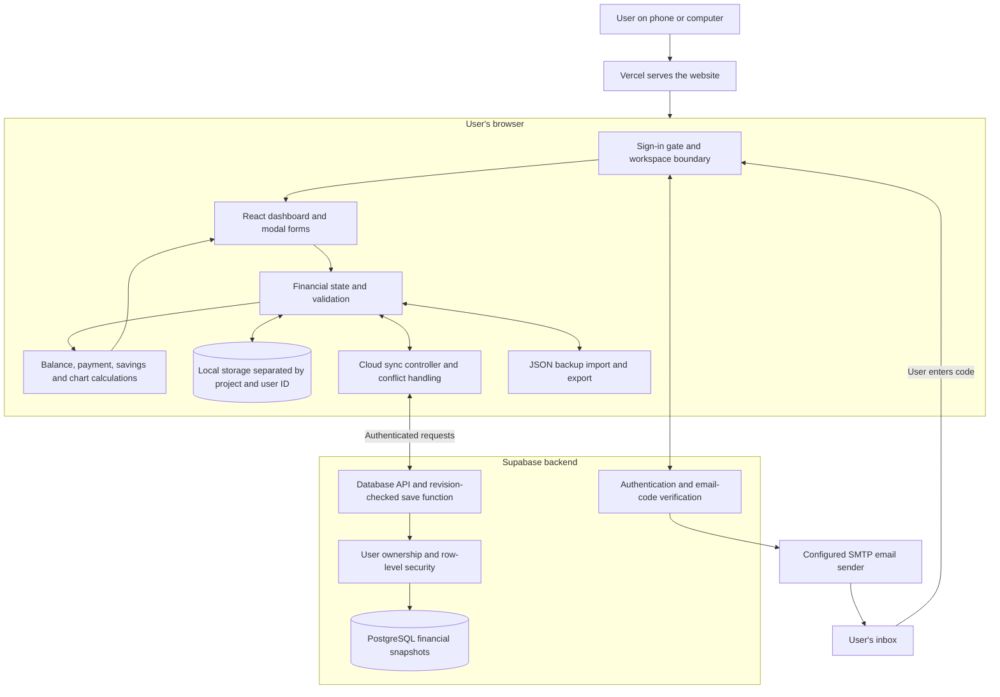

# Financial Tracker — System Architecture

This document describes the implemented structure as of November 9, 2026. A system flow describes what happens step by step; system architecture describes the parts of the system and how they connect. A wireframe describes the visual arrangement of the interface.

## Architecture diagram



Vercel hosts the built frontend. Financial calculations run in the browser. Supabase handles identity and cloud records; the app does not use a separate custom application server or bank API.

## Interface structure

```text
Financial Tracker
├── Signed out
│   └── Sign-in screen
│       ├── Email address / Send sign-in code
│       └── Email code / Verify code
└── Signed-in workspace
    ├── Account identity and Sign out
    ├── Header and appearance controls
    ├── Financial overview / Manage finances
    ├── Summary cards
    │   ├── Net balance
    │   ├── Next income date
    │   ├── Next bill due
    │   ├── Left to pay
    │   └── Payment attention
    ├── Safe to spend
    │   ├── Calculation breakdown
    │   └── Spending buffer
    ├── Accounts & transfers  |  Recent activity
    │                         ├── Search, filters and sorting
    │                         └── Filtered totals
    ├── Upcoming payment reminders
    ├── Payday planning
    ├── Monthly bills
    ├── Debts
    ├── Financial trends
    ├── Savings goals
    ├── Spending insights (expandable)
    │   ├── Charts
    │   └── Monthly budgets
    ├── Cloud sync
    └── Backup & restore
        └── Clear financial data
```

Accounts and Recent activity appear side by side on wider screens and stack on smaller screens. Manage finances opens a modal menu for transactions, budgets, categories, bills, recurring transactions, accounts, goals, debts, and scheduled income.

## Source-code structure

```text
financial-tracker/
├── src/
│   ├── main.jsx                 Application entry and workspace gate
│   ├── App.jsx                  Financial state and feature coordination
│   ├── components/              Dashboard sections, forms and reusable controls
│   ├── hooks/                   Workspace context, persistence and shared state logic
│   ├── utils/                   Calculations, validation, activity filtering and sync engine
│   ├── lib/supabase.js          Auth client and user-bound database clients
│   ├── constants/               Bank themes, providers and category definitions
│   └── styles/                  Dashboard, themes and control styling
├── public/                     Website icons and provider/bank assets
├── supabase/schema.sql         Cloud table, ownership rules and save function
├── docs/                       Setup, system flow and architecture documents
├── .env.example                Public connection-setting placeholders
└── .env.local                  Local configuration; excluded from Git
```

## Data ownership and persistence

| Layer | Responsibility |
|---|---|
| React state | Current workspace records, editing state, filters, and visible calculations. |
| User-scoped local storage | Financial records and preferences for a specific Supabase project and user ID. |
| User-scoped session storage | Session-only reminder dismissal state. |
| Supabase Auth | Sign-in sessions and verification of email codes. |
| Supabase database | One complete financial snapshot per user, with a revision and update time. |
| JSON exports | Independent financial backups controlled by the user. |

Financial snapshots contain transactions, accounts, transfers, budgets, categories, bills, debts, recurring schedules, savings goals, income plans, and the spending buffer. Theme, wallet design, and Net Balance visibility remain local; account-specific properties travel with account records.

## Important boundaries

- Financial screens are hidden until sign-in on a cloud-configured deployment.
- Account switching changes the local namespace and remounts the financial workspace.
- Each cloud request uses the token of its originating workspace. Sign-out aborts pending workspace requests.
- Cloud access is restricted by authenticated user ownership. Conflicting edits pause sync instead of silently replacing another device's changes.
- Local caches remain after sign-out and are not encrypted. This prevents normal in-app cross-account access, not inspection of the browser profile by someone with developer tools.
- Financial records describe money movement; they do not execute bank payments or transfers.
- Reconciliation, direct bank connections, receipt attachments, and split transactions are not implemented.
