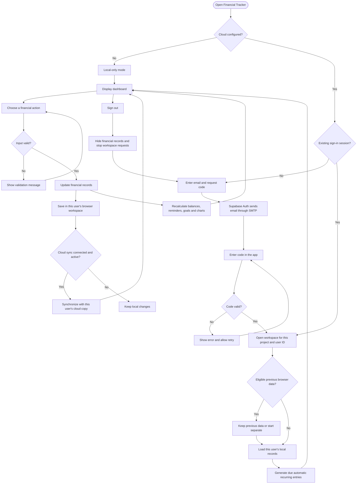
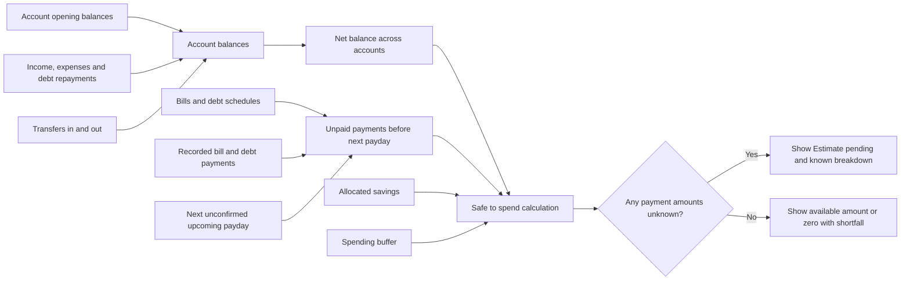
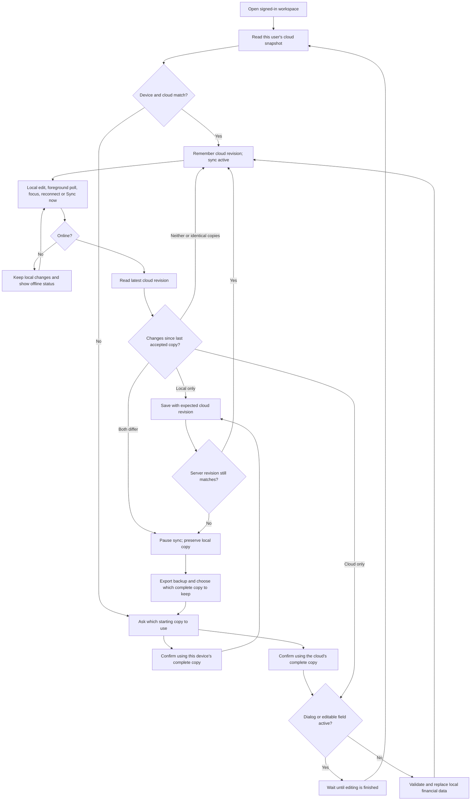
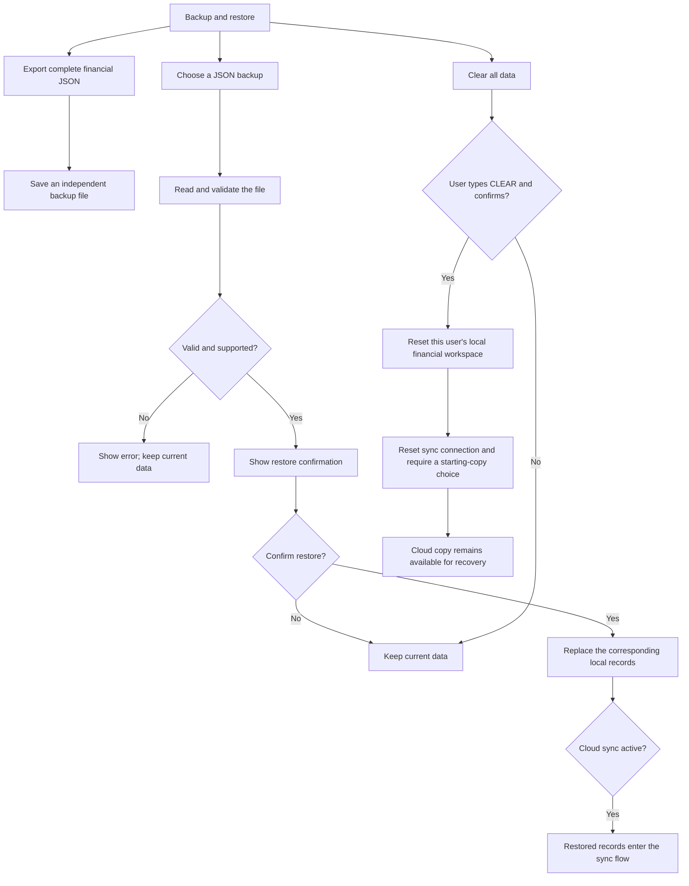

# Financial Tracker — System Flow

Updated: November 9, 2026. Describes the current implementation, including local changes awaiting deployment. Account reconciliation is a proposed feature and is not included in these flows.

## 1. Overall system flow

With cloud configuration present, financial components are not mounted while signed out. Local-only mode is a development/offline-storage fallback when Supabase settings are absent; it is not an offline sign-in bypass for a configured deployment.

## 2. Financial actions and their effects

| Feature | User action | Saved records and resulting behavior |
|---|---|---|
| Accounts | Add or edit an account, opening balance, bank, or color | Updates accounts; recalculates the account balance and net balance. |
| Account management | Reorder, mask, archive, or restore a card | Saves account properties. Archived balances remain included in net balance. Delete is limited to unused, zero-opening-balance accounts. |
| Other / Unassigned | Set its current balance to zero and save | Adjusts opening balance to offset recorded activity; preserves transactions and transfers. |
| Transactions | Add income or an expense | Saves the date, account, category, amount, and description; changes the selected account balance. |
| Transfers | Choose source, destination, and amount | Records a transfer after checking available funds. Updates both account balances without changing combined net balance or counting as income/expense. |
| Monthly budgets | Set category limits | Compares category expenses against limits; displays remaining budget and payment status. |
| Categories | Manage names, icons, and colors | Updates category definitions and corresponding displays/charts. |
| Monthly bills | Add fixed or variable bill schedules | Calculates monthly due dates. Variable bills require each month's amount before payment. |
| Bill payment | Record a payment from an account | Creates a linked expense with bill ID and billing month; updates paid/remaining amount and reminders. |
| Debts | Add a debt and payment schedule | Stores opening principal, first due date, optional final due date, and fixed/variable monthly amounts. Fixed amounts can be calculated from a total repayment over the selected months; variable statements are entered individually. Recording an existing debt does not add income or cash. |
| Debt repayment | Enter principal, fees, account, date, and billing month | Saves linked principal and optional fee entries. Principal reduces debt; fees count as expense; both reduce the payment account. |
| Automatic recurring transactions | Create an income/expense rule | Generates due monthly transactions on load, rule updates, and periodic/focus checks. Uses checkpoints to avoid recreating processed entries. |
| Scheduled income | Set income name, paydays, category, and account | Displays expected payday dates without adding money to the balance. |
| Confirm received | Enter actual income amount, date, and account | Saves an income transaction linked to its planned payday; prevents duplicate confirmation for the same occurrence. |
| Savings goals | Set a target and allocate/release savings | Reserves funds from an account without creating an expense or changing net balance. |
| Activity filters | Search by text, account, type, category, dates, or amounts | Filters records and shows matching totals; does not modify financial data. Transfers match either account. |
| Financial trends | Choose category and date range | Displays category history and net-balance history as line graphs. |

The app records activity; it does not move money through banks or automatically retrieve bank balances.

## 3. Dashboard calculations

- Account balance = opening balance + income − expenses − debt principal + transfers in − transfers out.
- Safe to spend = current net balance − unpaid bills/debt in the window − allocated savings − buffer, with the displayed allowance limited to zero or above.
- The window includes overdue items and ends before the next payday. Payments on payday are excluded. Without a payday, the window runs through month end.
- Expected salary is excluded until confirmed received. Unknown payment amounts are flagged rather than presented as a complete estimate.
- Filtered net activity is separate from account balance: it excludes opening balances and includes only matching records. Transfers affect filtered net activity only when an account is selected.

## 4. Cloud synchronization

Cloud data is one validated financial snapshot per authenticated user in `tracker_snapshots`. The snapshot contains transactions, accounts, transfers, budgets, categories, bills, debts, recurring schedules, savings goals, scheduled income, and spending buffer. Repayment links and billing-month metadata remain part of transaction records.

- Local changes trigger a sync after about 1.2 seconds. Foreground cloud checks run every 20 seconds and on focus/reconnection.
- Requests use the signed-in workspace's token and are aborted when that workspace closes. Database ownership rules restrict cloud access to that user.
- The server uses an expected revision to reject stale writes. The system chooses whole snapshots; it does not automatically merge competing edits.
- Refreshing/reopening the app may require choosing a starting copy again if device and cloud differ.
- Network failures preserve local records and show an error/offline state. Sync can be retried.
- Buttons show loading feedback during checking, syncing, uploading, downloading, and sign-out. Pause remains available during sync.

## 5. Backups, restore, and clear data

Transaction-list CSV/JSON exports contain transactions only. Backup & restore is the full financial backup. Display preferences, authentication tokens, and other users' workspaces are not included in the financial export.

## 6. Sign-out, account switching, and migration

Signing out immediately hides the dashboard, aborts workspace requests, stops sync, and ends the local Supabase session. Other devices remain signed in. The saved local cache is retained in that user's namespace for their next sign-in; another login has a different namespace and starts with its own data.

During upgrade from the old shared storage, the app saves a recovery copy before removing shared keys. Only an account already signed in at startup is offered that previous data, and restoration requires confirmation. If there is no known initial owner, the recovery copy is retained but is not automatically assigned to a new login.

Local storage and the migration recovery copy are not encrypted. Account separation prevents display and normal app access across logins; it is not protection against someone inspecting a browser profile with developer tools. Cloud records use Supabase access controls, not end-to-end encryption.

## Implementation map

| Responsibility | Main implementation |
|---|---|
| Sign-in and user boundary | `src/components/WorkspaceRoot.jsx`, `src/components/SignInForm.jsx` |
| Per-user storage and migration | `src/utils/workspaceStorage.js`, `src/hooks/useWorkspace.js` |
| Financial state and feature actions | `src/App.jsx` |
| Dashboard arrangement | `src/components/DashboardLayout.jsx` |
| Balance and spending calculations | `src/utils/accounts.js`, `src/utils/safeToSpend.js` |
| Bills, debts, payday plans, goals | `src/utils/bills.js`, `src/utils/debts.js`, `src/utils/incomePlans.js`, `src/utils/savings.js` |
| Cloud controls and conflict engine | `src/components/CloudSync.jsx`, `src/utils/cloudSnapshot.js` |
| Cloud database ownership and revision checks | `supabase/schema.sql` |
| File backup validation | `src/components/DataBackup.jsx`, `src/utils/backupValidation.js` |
